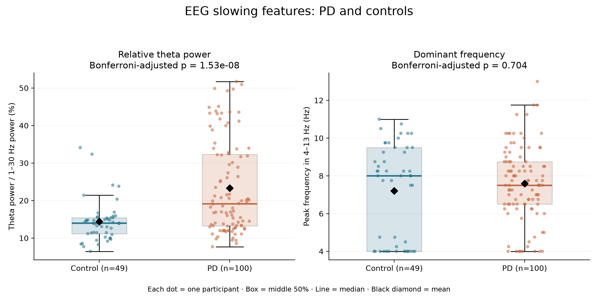
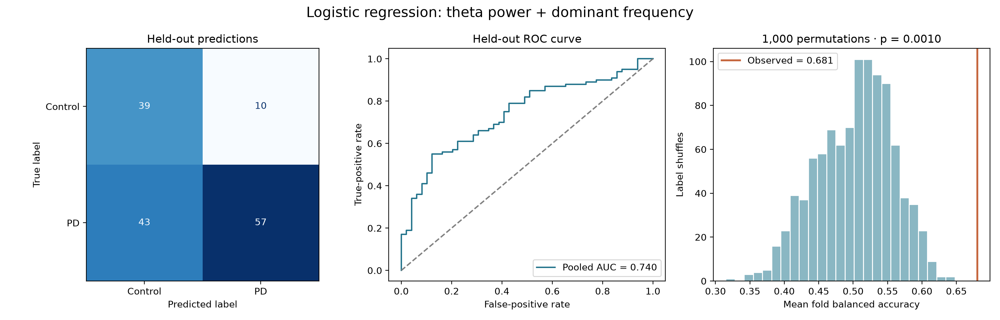

# Parkinson’s Disease EEG: From Preprocessing to Classification

> **Project update — 26 October 2026**
>
> I’m building this project as part of my computational neuroscience learning journey. The first version focused on cleaning EEG recordings. I’ve now processed all 149 participants, extracted two spectral features, compared the groups, and tested a simple machine-learning model.
>
> This is an exploratory analysis with internal cross-validation, not a validated diagnostic tool.

[Preprocessing](Scripts/PD_EEG_FIRST.py) · [Feature extraction](Scripts/PD_EEG_FEATURES.py) · [Group comparisons](Scripts/PD_EEG_COMPARE.py) · [Machine learning](Scripts/PD_EEG_ML.py)

## What I wanted to investigate

The question was whether the Parkinson’s disease group showed signs of EEG slowing, and whether a small set of slowing-related features could help distinguish PD participants from controls.

I kept the analysis focused on two features: relative theta power and dominant frequency between 4 and 13 Hz. I wanted a pipeline I could understand and explain, from the original recordings to the final predictions.

The scientific motivation came from [Geraedts et al. (2018), Clinical correlates of quantitative EEG in Parkinson disease](https://pubmed.ncbi.nlm.nih.gov/30291182/). My analysis uses Welch spectral estimates rather than their wavelet-based measures, so it is not a replication of that paper.

## The dataset

I used the resting-state eyes-open dataset available through [OpenNeuro ds004584](https://openneuro.org/datasets/ds004584) and its [NEMAR copy](https://nemar.org/dataset/on004584). The analysis includes **149 participants: 100 with PD and 49 controls**.

The recordings belong to the dataset authors. This project documents the processing and analysis of those recordings.

## From recordings to cleaned epochs

The preprocessing combines MNE-Python, PyPREP, MNE-ICALabel and AutoReject:

```text
Load recording and prepare channel-position metadata
   ↓
Detect bad channels and apply average reference
   ↓
Create 1–40 Hz analysis data and 1–100 Hz ICA data
   ↓
Use two-second epochs to select data for ICA
   ↓
Fit extended Infomax ICA and label components
   ↓
Remove confidently labelled artifacts and interpolate bad channels
   ↓
Create four-second epochs and apply AutoReject
   ↓
Reapply average reference and save cleaned epochs
```

Components labelled as artifacts were removed when their classification confidence was at least 0.90. Components labelled brain or other were retained. Cleaned epochs are saved as participant-specific `-epo.fif` files, allowing later analysis without repeating preprocessing. A processing log records saved, excluded and failed recordings; the current workflow no longer generates the earlier QC workbook.

### A problem I had to work through

Thirty participants initially failed processing. The channel tables included `Resp` for 29 participants and `X`, `Y`, `Z` for one participant. Their types and units were unspecified, and the README did not establish what these sensors measured.

These named channels were omitted from the scalp-EEG analysis. I have not treated their names as confirmation of their sensor types. Removing them alone was not enough: the retry run still failed with an SVD error during interpolation in the recording inspected.

A diagnostic on `sub-049` showed that the remaining channel coordinates were valid, but an invalid point remained in the separate digitization metadata. Rebuilding the montage from the remaining EEG coordinates resolved the head-sphere calculation. After adding this correction, all 30 retry participants completed preprocessing. The later feature-extraction run successfully read all 149 saved recordings.

The correction preserves the remaining EEG coordinates; it does not replace them with a standard template. The original recording files are unchanged.

## The two features

| Feature | Calculation | Expected direction for slowing |
| --- | --- | --- |
| Relative theta power | Power from 4 ≤ f < 8 Hz divided by power from 1 ≤ f < 30 Hz | Higher |
| Dominant frequency | Frequency with the greatest average spectral power between 4 and 13 Hz, inclusive | Lower |

Welch spectra use a Hamming window spanning each saved epoch. Spectra are averaged across epochs first. Relative theta power is calculated per channel and then averaged across channels. Dominant frequency is obtained from the channel-averaged spectrum.

This produces one row per participant in `EEG_features.csv`. The table also retains epoch counts, channel counts, retained duration and a flag for peaks at the edge of the frequency search range.

## What the group comparisons showed

I used two-sided Welch t-tests, with Bonferroni correction across the two features. Welch’s test allows the groups to have different variances. I also calculated mean differences, 95% confidence intervals and Hedges’ g to describe the size of the differences.

| Feature | PD mean | Control mean | Bonferroni-adjusted p |
| --- | --- | --- | --- |
| Relative theta power | 23.35% | 14.38% | 1.53 × 10⁻⁸ |
| Dominant frequency | 7.59 Hz | 7.21 Hz | 0.704 |



Relative theta power was **8.97 percentage points higher** in PD, with a 95% confidence interval of 6.08–11.86 points and Hedges’ g of 0.84. These confidence intervals are not adjusted for multiple comparisons.

The dominant-frequency result did not support lower mean frequency in PD. Its mean difference was +0.38 Hz, with a 95% confidence interval from −0.43 to +1.20 Hz. Fourteen controls and nine PD participants had peaks at the search boundary, which limits the interpretation of this measure.

The group-level evidence for slowing in this analysis therefore comes from relative theta power, not from both features.

## Moving to machine learning

The next question was whether the two features could predict group membership for participants held out of training.

I used logistic regression with both features, balanced class weights and five-fold stratified cross-validation. Standardisation happens inside each training fold. Each participant receives one prediction from a model trained without that participant.

The model uses `C=1.0`, the `lbfgs` solver and the default classification threshold. Both features were retained; there was no model search or threshold tuning. A fixed seed of 42 makes the split and permutation procedure reproducible.

| Measure | Result |
| --- | --- |
| Mean fold balanced accuracy | **68.1%** |
| Mean fold ROC AUC | **0.760** |
| Pooled held-out balanced accuracy | 68.3% |
| Pooled held-out ROC AUC | 0.740 |
| PD sensitivity | 57.0% — 57 of 100 correctly identified |
| Control specificity | 79.6% — 39 of 49 correctly identified |
| Permutation p-value | **0.000999**, approximately 0.001 |



Balanced accuracy gives equal importance to the success rate in each group. That matters here because there are roughly twice as many PD participants as controls.

For the permutation test, the labels were shuffled 1,000 times and the full scaling-plus-classification pipeline was refitted with cross-validation. None of the shuffled scores reached the observed mean fold balanced accuracy. Using the standard correction, the p-value is `(0 + 1) / (1000 + 1)`, rather than zero. The implementation uses scikit-learn’s existing `permutation_test_score` function.

The mean fold metrics average five separate scores. The pooled metrics combine all held-out predictions, which explains why the values differ slightly.

## What I take from this

Higher relative theta power in PD is consistent with increased slow-frequency activity. The classifier also performed better than expected under shuffled labels, but the result is moderate: it missed 43 of the 100 PD participants, and balanced accuracy varied from 55% to 80% across folds.

These are internal results from one dataset. The analysis does not establish an individual diagnosis, cognitive decline or causation. Age, medication and other possible confounders have not been adjusted for. The dominant-frequency feature also needs cautious interpretation because it uses a whole-scalp maximum and has several boundary peaks.

One useful lesson for me was separating three questions: whether the code runs, whether the groups differ, and whether a model predicts held-out participants well. They are related, but answering one does not settle the others.

## Running the analysis

Dependencies are MNE-Python, NumPy, pandas, SciPy, Matplotlib, scikit-learn, PyPREP, MNE-ICALabel and AutoReject.

Place `participants.tsv` beside the scripts and the cleaned epochs in `preprocessed_eeg/`, then run:

```bash
python PD_EEG_FEATURES.py
python PD_EEG_COMPARE.py
python PD_EEG_ML.py
```

To regenerate cleaned epochs, configure `DATA_DIR` in `PD_EEG_FIRST.py`. The current local preprocessing script still contains the temporary retry-participant filter; remove that filter for a full-dataset run while retaining the channel and montage corrections. This does not require rerunning the already saved recordings.

The figures in this page use relative paths. Include the two plotted PNG files in the corresponding folders when uploading this entry.

## References

- [OpenNeuro dataset ds004584](https://openneuro.org/datasets/ds004584)
- [NEMAR dataset on004584](https://nemar.org/dataset/on004584)
- [Novak et al.: qEEG and cognitive dysfunction in PD](https://www.frontiersin.org/journals/aging-neuroscience/articles/10.3389/fnagi.2021.804991/full)
- [MNE-Python ICA](https://mne.tools/stable/generated/mne.preprocessing.ICA.html)
- [MNE-ICALabel component classification](https://mne.tools/mne-icalabel/stable/generated/examples/00_iclabel.html)
- [AutoReject workflow with ICA](https://autoreject.github.io/stable/auto_examples/plot_autoreject_workflow.html)
- [SciPy Welch t-test](https://docs.scipy.org/doc/scipy/reference/generated/scipy.stats.ttest_ind.html)
- [Scikit-learn permutation testing](https://scikit-learn.org/stable/modules/generated/sklearn.model_selection.permutation_test_score.html)
