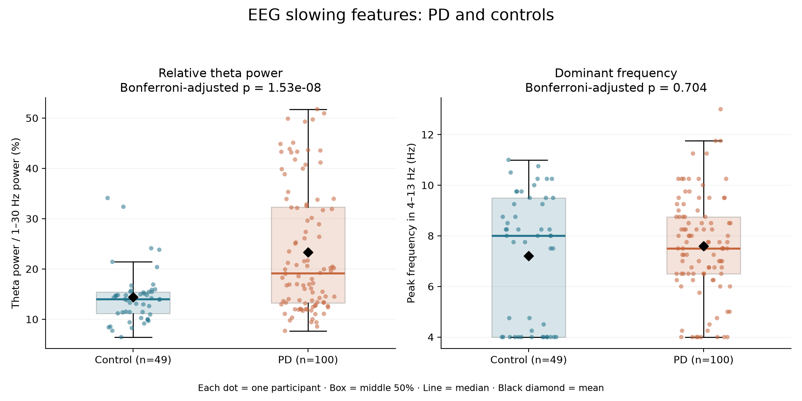
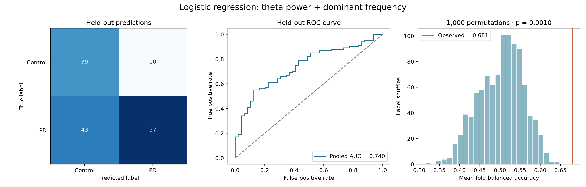

# Parkinson’s Disease EEG: From Preprocessing to Classification

> **Project update — 5 November 2026**
>
> I built this project as part of my computational neuroscience learning journey, developing an EEG preprocessing pipeline, extracting spectral biomarkers and testing classification models. I extended the original logistic-regression baseline with nested cross-validation, regularization tuning and comparisons of biomarkers and classifiers.
>
> This is a completed exploratory analysis with internal cross-validation, not a validated diagnostic tool.

[Preprocessing](Scripts/PD_EEG_FIRST.py) · [Feature extraction](Scripts/PD_EEG_FEATURES.py) · [Group comparisons](Scripts/PD_EEG_COMPARE.py) · [Machine learning](Scripts/PD_EEG_ML.py) · [Comparison Testing](Scripts/PD_EEG_ML_COMPARISON.py)

## What I wanted to investigate

The question was whether the Parkinson’s disease group showed signs of EEG slowing, and whether a small set of slowing-related features could help distinguish PD participants from controls.

I kept the analysis focused on two features: relative theta power and dominant frequency between 4 and 13 Hz. I wanted a pipeline I could understand and explain, from the original recordings to the final predictions.

The scientific motivation came from [Geraedts et al. (2018), Clinical correlates of quantitative EEG in Parkinson disease](https://pubmed.ncbi.nlm.nih.gov/30291182/).

## The dataset

I used the resting-state eyes-open dataset available through [OpenNeuro ds004584](https://openneuro.org/datasets/ds004584) and its [NEMAR copy](https://nemar.org/dataset/on004584). The analysis includes **149 participants: 100 with PD and 49 controls**.

The recordings belong to the dataset authors. This project documents the processing and analysis of those recordings.

## From recordings to cleaned epochs

The preprocessing combines MNE-Python, PyPREP, MNE-ICALabel and AutoReject:

```text
Load recording and prepare channel-position metadata
   ↓
Detect bad channels and apply average reference
   ↓
Create 1–40 Hz analysis data and 1–100 Hz ICA data
   ↓
Use two-second epochs to select data for ICA
   ↓
Fit extended Infomax ICA and label components
   ↓
Remove confidently labelled artifacts and interpolate bad channels
   ↓
Create four-second epochs and apply AutoReject
   ↓
Reapply average reference and save cleaned epochs
```

Components labelled as artifacts were removed when their classification confidence was at least 0.90. Components labelled brain or other were retained. Cleaned epochs are saved as participant-specific `-epo.fif` files, allowing later analysis without repeating preprocessing. A processing log records saved, excluded and failed recordings; the current workflow no longer generates the earlier QC workbook.

### A problem I had to work through

Thirty participants initially failed processing. The channel tables included `Resp` for 29 participants and `X`, `Y`, `Z` for one participant. Their types and units were unspecified, and the README did not establish what these sensors measured.

These named channels were omitted from the scalp-EEG analysis. I have not treated their names as confirmation of their sensor types. Removing them alone was not enough: the retry run still failed with an SVD error during interpolation in the recording inspected.

A diagnostic on `sub-049` showed that the remaining channel coordinates were valid, but an invalid point remained in the separate digitization metadata. Rebuilding the montage from the remaining EEG coordinates resolved the head-sphere calculation. After adding this correction, all 30 retry participants completed preprocessing. The later feature-extraction run successfully read all 149 saved recordings.

The correction preserves the remaining EEG coordinates; it does not replace them with a standard template. The original recording files are unchanged.

## The two features

| Feature | Calculation | Expected direction for slowing |
| --- | --- | --- |
| Relative theta power | Power from 4 ≤ f < 8 Hz divided by power from 1 ≤ f < 30 Hz | Higher |
| Dominant frequency | Frequency with the greatest average spectral power between 4 and 13 Hz, inclusive | Lower |

Welch spectra use a Hamming window spanning each saved epoch. Spectra are averaged across epochs first. Relative theta power is calculated per channel and then averaged across channels. Dominant frequency is obtained from the channel-averaged spectrum.

This produces one row per participant in `EEG_features.csv`. The table also retains epoch counts, channel counts, retained duration and a flag for peaks at the edge of the frequency search range.

## What the group comparisons showed

I used two-sided Welch t-tests, with Bonferroni correction across the two features. Welch’s test allows the groups to have different variances. I also calculated mean differences, 95% confidence intervals and Hedges’ g to describe the size of the differences.

| Feature | PD mean | Control mean | Bonferroni-adjusted p |
| --- | --- | --- | --- |
| Relative theta power | 23.35% | 14.38% | 1.53 × 10⁻⁸ |
| Dominant frequency | 7.59 Hz | 7.21 Hz | 0.704 |



Relative theta power was **8.97 percentage points higher** in PD, with a 95% confidence interval of 6.08–11.86 points and Hedges’ g of 0.84. These confidence intervals are not adjusted for multiple comparisons.

The dominant-frequency result did not support lower mean frequency in PD. Its mean difference was +0.38 Hz, with a 95% confidence interval from −0.43 to +1.20 Hz. Fourteen controls and nine PD participants had peaks at the search boundary, which limits the interpretation of this measure.

The group-level evidence for slowing in this analysis therefore comes from relative theta power, not from both features.

## Initial machine-learning baseline

I first tested logistic regression using both features, balanced class weights and five-fold stratified cross-validation. Scaling was performed inside the pipeline, with fixed `C=1` and seed 42.

| Measure | Result |
| --- | ---: |
| Mean fold balanced accuracy | 68.1% |
| Mean fold ROC AUC | 0.760 |
| Pooled held-out ROC AUC | 0.740 |
| PD sensitivity | 57.0% |
| Control specificity | 79.6% |
| Permutation p-value, 1,000 shuffles | 0.001 |



## Revisiting the baseline

As I learned more about model evaluation, I tested whether tuning, different features or nonlinear classifiers could improve the result.

### Nested cross-validation

I used five outer folds for evaluation and five inner folds to select hyperparameters. For logistic regression, the search tested `C = [0.001, 0.01, 0.1, 1, 10, 100]`. The tuned two-feature model achieved 68.6% mean outer balanced accuracy.

### Testing the biomarkers separately

| Logistic-regression inputs | Mean outer balanced accuracy | Mean outer ROC AUC |
| --- | ---: | ---: |
| Theta only | 70.39% | 0.708 |
| Dominant frequency only | 45.22% | 0.507 |
| Both | 68.56% | 0.756 |

Theta alone had the highest balanced accuracy. Dominant frequency alone showed little discrimination, although combining the features improved AUC relative to theta alone.

### Comparing models

I compared logistic regression, RBF SVM and random forest using theta alone and both features. All combinations used the same outer splits, with model-specific tuning inside the inner folds.

| Inputs | Model | Mean outer balanced accuracy | Fold SD, percentage points | Mean outer ROC AUC |
| --- | --- | ---: | ---: | ---: |
| Theta only | Logistic regression | 70.39% | 8.76 | 0.708 |
| Theta only | RBF SVM | 67.89% | 7.20 | 0.662 |
| Theta only | Random forest | 70.67% | 8.36 | 0.762 |
| Both | Logistic regression | 68.56% | 8.94 | 0.756 |
| Both | RBF SVM | 67.89% | 10.48 | 0.724 |
| Both | Random forest | 65.56% | 9.85 | 0.748 |

## What I found

Theta-only models matched or exceeded the balanced accuracy of combined-feature models across all three classifiers. Random forest had the highest observed scores, but its balanced accuracy was only 0.28 percentage points above logistic regression. More complex models did not produce a clear gain in classification performance.

I retain theta-only logistic regression as the interpretable reference, with random forest as the leading alternative. The model comparison is exploratory; it does not establish a definitive winner or independent validation of the selected model.

The main improvement was a more systematic evaluation of my original choices as I was unable to achieve a large increase in accuracy.

## References

- Geraedts VJ, Boon LI, Marinus J, Gouw AA, van Hilten JJ, Stam CJ, et al. Clinical correlates of quantitative EEG in Parkinson disease. *Neurology*. 2018;91(19):871–883. [doi:10.1212/WNL.0000000000006473](https://doi.org/10.1212/WNL.0000000000006473).
- [OpenNeuro ds004584](https://openneuro.org/datasets/ds004584)
- [NEMAR on004584](https://nemar.org/dataset/on004584)
- [MNE-Python ICA](https://mne.tools/stable/generated/mne.preprocessing.ICA.html)
- [PyPREP](https://pyprep.readthedocs.io/en/stable/)
- [MNE-ICALabel](https://mne.tools/mne-icalabel/stable/)
- [AutoReject workflow with ICA](https://autoreject.github.io/stable/auto_examples/plot_autoreject_workflow.html)
- [SciPy Welch t-test](https://docs.scipy.org/doc/scipy/reference/generated/scipy.stats.ttest_ind.html)
- [Scikit-learn logistic regression](https://scikit-learn.org/stable/modules/generated/sklearn.linear_model.LogisticRegression.html)
- [Scikit-learn SVM](https://scikit-learn.org/stable/modules/generated/sklearn.svm.SVC.html)
- [Scikit-learn random forest](https://scikit-learn.org/stable/modules/generated/sklearn.ensemble.RandomForestClassifier.html)
- [GridSearchCV](https://scikit-learn.org/stable/modules/generated/sklearn.model_selection.GridSearchCV.html)
- [Nested cross-validation](https://scikit-learn.org/stable/auto_examples/model_selection/plot_nested_cross_validation_iris.html)
- [Permutation testing](https://scikit-learn.org/stable/modules/generated/sklearn.model_selection.permutation_test_score.html)
